# tgbridge

[](https://github.com/romcodedao/tgbridge/actions/workflows/ci.yml)
[](https://github.com/romcodedao/tgbridge/releases)
[](LICENSE)
[](https://goreportcard.com/report/github.com/romcodedao/tgbridge)

Drive real Claude Code sessions from a private Telegram chat: one topic per session, live streaming with thinking, and permission prompts as buttons.

> **Risk.** tgbridge lets your Telegram account run Claude Code as your user on this machine. Anyone who controls that account, or the bot token, can use your files and tools. Read [Security](#security-model) first.

Not affiliated with Anthropic or Telegram.

<!-- TODO: demo GIF (add it here once recorded) -->

It runs the `claude` CLI already installed on your machine, as a background service (systemd on Linux, launchd on macOS). Only your Telegram account can use it. It long-polls Telegram, so it needs no open port.



<sub>Diagram source: [`docs/architecture.html`](docs/architecture.html)</sub>

## Requirements

- Linux with systemd, or macOS. Linux and macOS, amd64 and arm64.
- **Windows:** install Claude Code inside WSL2 and run tgbridge there. There is no Windows binary.
- [Claude Code](https://docs.claude.com/en/docs/claude-code) installed and logged in (`claude` runs in a terminal).
- A Telegram account.

## Install

### 1. Create the bot (phone)

In [@BotFather](https://t.me/BotFather) send `/newbot` and copy the token. Then in the BotFather Mini App → your bot → **Threads Settings**, turn **Threaded Mode** on and leave "Disallow users to create new threads" off. Open your bot and press **Start**.

### 2. Run the installer (machine)

```bash
curl -fsSL https://raw.githubusercontent.com/romcodedao/tgbridge/main/install.sh | sh
```

It downloads the release for your machine, checks its sha256, puts `tgbridge` in `~/.local/bin`, then starts `tgbridge init`. The wizard asks for your bot token (hidden), waits for your first message to the bot to learn your user ID, and installs and starts the service. Expected:

```text
Claude Code:
  ok    claude        /home/you/.local/bin/claude 2.1.0
  ok    claude login  logged in (claude.ai)
Wrote /home/you/.config/tgbridge/config.yaml
Create a bot with @BotFather (/newbot) and paste its token here (input is hidden).
Bot token:
Saved the token to /home/you/.config/tgbridge/token
Bot: @yourbot
Send any message to @yourbot now, in a private chat (Ctrl+C to cancel)...
Message from Dat (@dat), user ID 123456789. This account will control Claude on this machine.
Is this you? [Y/n]
Saved owner_id: 123456789
Installed the systemd service: /home/you/.config/systemd/user/tgbridge.service

Summary:
  ok    ...
Done. Send @yourbot a message: a new topic starts your first session.
```

Check the name before you answer `Y`: that account will control Claude on this machine. Send the bot a message on your phone: a new topic opens with your Claude session.

To keep it running after you log out on Linux: `sudo loginctl enable-linger $USER` (`tgbridge doctor` tells you if it's off).

`init` is safe to re-run. It skips what is already done and fixes what is broken.

**Read it first.** To read the script before it runs:

```bash
curl -fsSL -o install.sh https://raw.githubusercontent.com/romcodedao/tgbridge/main/install.sh
less install.sh
sh install.sh
```

**With Go** (the binary lands in `$(go env GOPATH)/bin`, which must be on your PATH):

```bash
go install github.com/romcodedao/tgbridge/cmd/tgbridge@latest
tgbridge init
```

Manual steps, installer options, macOS notes and WSL2: [docs/install.md](docs/install.md).

## Uninstall

```bash
tgbridge uninstall
```

It removes the service and the Claude Code hooks. Your config, token and state stay. Add `--purge` to delete those too, or `--dry-run` to see the plan first: [docs/install.md](docs/install.md#uninstall).

## Configure

Everything lives in `~/.config/tgbridge/config.yaml` ([example](config.example.yaml)). The settings you're most likely to change:

| Setting | Default | What it does |
|---|---|---|
| `owner_id` | *(required)* | The only Telegram account the bot answers |
| `default_cwd` | `~` | Folder new sessions start in (`/new <path> <task>` overrides it) |
| `model` | Claude Code's default | `claude --model` for Telegram sessions |
| `engine.permission_mode` | `ask` | `ask`, `auto` or `full`: how much Claude may do without asking |
| `orca_enabled` | `false` | Optional Orca integration (see below) |

All settings: [docs/configuration.md](docs/configuration.md).

## Security model

- **One owner.** Only `owner_id` can use the bot. Groups are left, other accounts are ignored, and messages are rate-limited.
- **You approve actions.** In `ask` mode, anything beyond reading files asks you with buttons. Each prompt has a single-use nonce and expires.
- **Secrets stay out of reach.** The Read tool is always denied SSH keys, `.env` files, cloud and Git credentials, and tgbridge's own token and state. The token is removed from the daemon's environment, so Claude never inherits it.
- **No inbound port.** Telegram is reached by outbound long polling. The local socket is mode 600.
- **Audit log** of every message (length only) and approval decision.

The deny list blocks the Read tool, not every shell command: that's why `ask` mode asks before any other Bash command. Details and limits: [docs/security.md](docs/security.md). To report a vulnerability: [SECURITY.md](SECURITY.md).

## Limits

- One owner, private chat only. Telegram's Threaded Mode must be on.
- One machine per bot token: two copies polling the same token conflict (`409 Conflict`).
- Files up to 20 MB (the Telegram bot limit). Voice, video, audio and stickers aren't supported.
- Long conversations are kept small: a warning at 80k tokens, an automatic fresh start with a summary at 150k, at most 3 Claude processes at once. All configurable.
- Claude runs as your user with your Claude Code setup. In `auto` and `full` modes, Claude Code's own rules decide what runs without asking.

## Optional: Orca integration

If you use the Orca multi-agent IDE, set `orca_enabled: true`. `/sessions` then lists Orca agents, `/status` shows their last messages, and you can hand a running Orca Claude session off to Telegram (run `tgbridge hooks install` once). Without it, tgbridge doesn't need or call Orca. See [Using the bot](docs/usage.md#optional-orca-integration).

## Day to day

| I want to… | Run |
|---|---|
| Check everything | `tgbridge doctor` |
| Check it's running | `tgbridge service status` |
| Apply a config change (re-installs and restarts the service) | `tgbridge service install` |
| Watch the log (Linux) | `journalctl --user -u tgbridge -f` |
| Watch the log (macOS) | `tail -f ~/Library/Logs/tgbridge.log` |
| Update | Run the installer again (it keeps your config) |

Source checkouts also have `make` shortcuts: [docs/operations.md](docs/operations.md).

In Telegram: `/help` lists the commands. `/mode ask|auto|full` sets how much Claude may do without asking. `/stop` interrupts. `/exit` ends a session.

## Docs

- [Using the bot](docs/usage.md): topics, photos and files, commands, permission modes, context limits, Orca
- [Install](docs/install.md): installer options, manual install, macOS, WSL2, uninstall
- [Operations](docs/operations.md): day-to-day commands, files, troubleshooting
- [Configuration](docs/configuration.md): every setting in `config.yaml`
- [Upgrading and moving to another machine](docs/migration.md): read the upgrade notes before updating
- [Security](docs/security.md)
- [Development](docs/development.md): tests, code layout, releases

## Contributing

See [CONTRIBUTING.md](CONTRIBUTING.md) and the [Code of Conduct](CODE_OF_CONDUCT.md). Licensed under the [MIT License](LICENSE).
